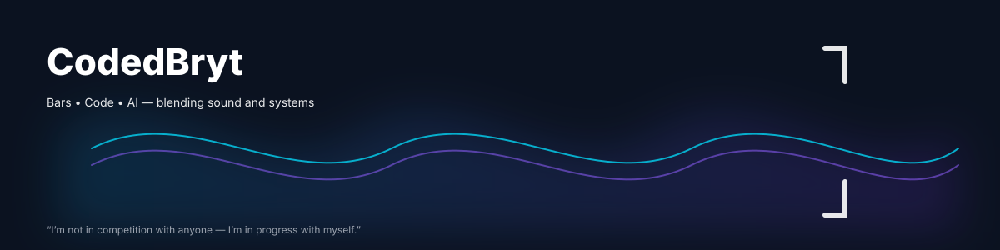

# 👋 Hi, I’m CodedBryt

Frontend Developer building clean, responsive, and problem-solving web experiences — with a growing focus on AI-enhanced products.

---

## 🧠 What I Do
- Build responsive websites using **HTML, CSS, and JavaScript**
- Translate UI/UX designs into functional web products
- Collaborate with designers, analysts, and teams to ship products
- Explore **AI-powered solutions** and automation for real-world use cases

---

## 🛠 Tech Stack
**Frontend:**  
HTML • CSS • JavaScript  

**Tools & Workflow:**  
Git • GitHub • VS Code • Responsive Design • Web Performance Optimization  

**AI / Emerging Skills:**  
Prompt Engineering • AI-assisted workflows *(actively expanding)*

---

## 🚀 Projects
Here are some things I’ve built or am currently working on:
- Business websites for real-world use cases  
- Product-focused frontend builds  
- Team-based projects from internships and programs  

👉 Check out my pinned repositories below.

---

## 👥 Team & Collaboration
I lead and collaborate with a small cross-functional team including:
- UI/UX Designers  
- Data Analysts  

We focus on building practical products and improving with every iteration.

---

## 🌍 Goals
- Grow as a **full-stack developer**
- Build AI-enhanced products that solve real problems
- Work with global teams and companies
- Create sustainable opportunities through tech

---

## 📫 Let’s Connect
- X (Twitter): https://x.com/yourhandle  
- LinkedIn: https://linkedin.com/in/yourprofile  

Open to roles, collaborations, and meaningful projects.

---

> *Build websites. Solve problems. Ship products.*
